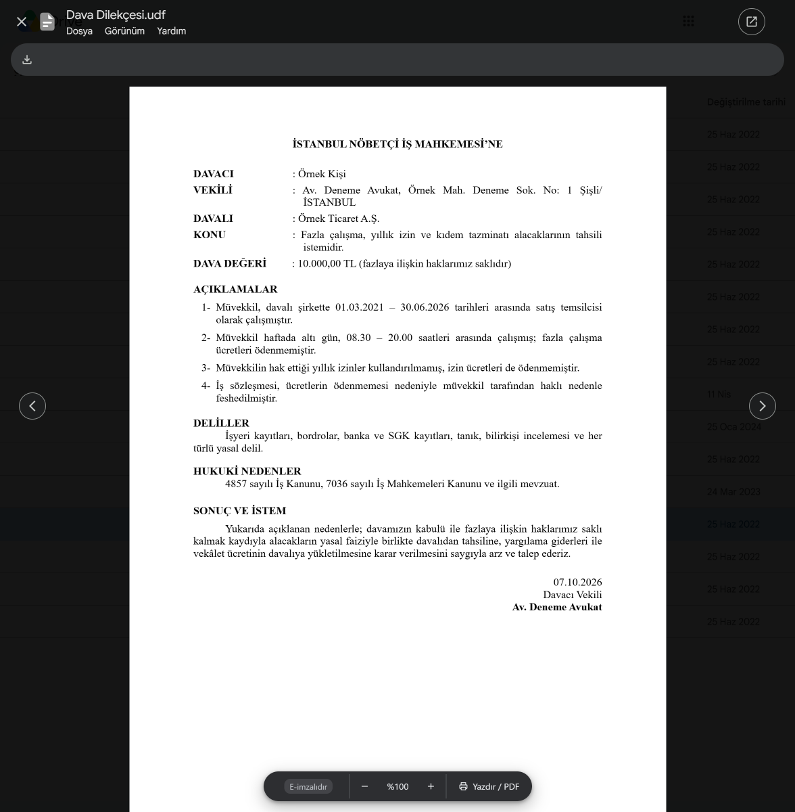
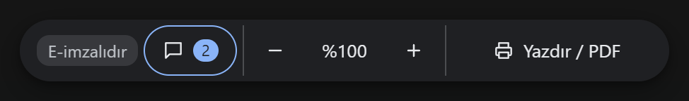
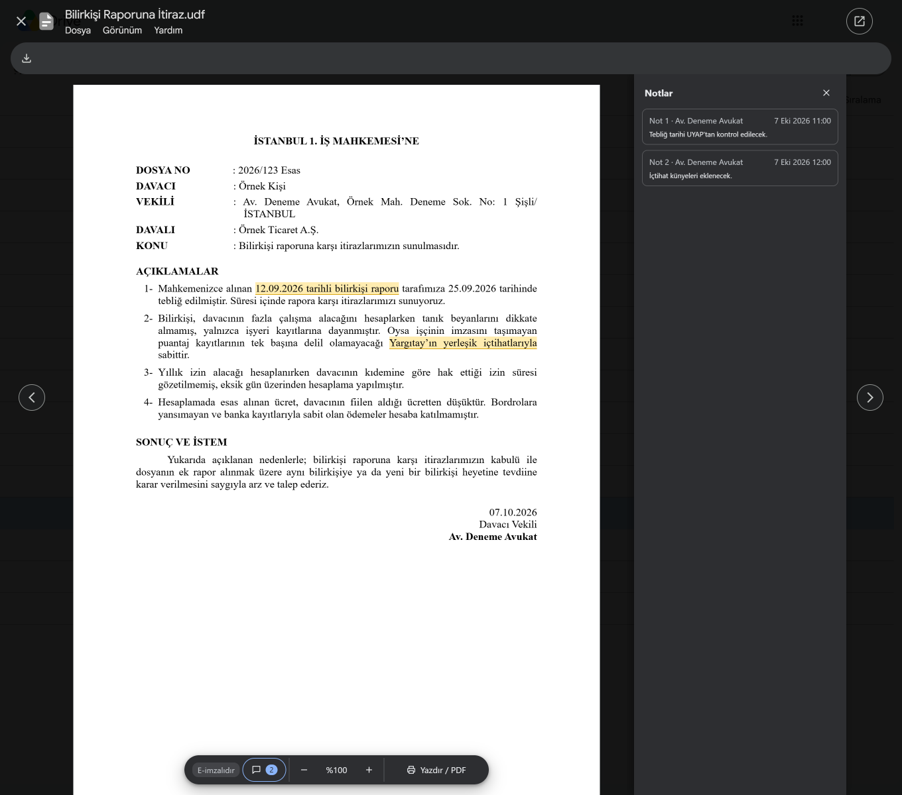

# UDF Ön İzleme

### ⬇ Chrome Web Mağazası'ndan ekle

Mağaza bağlantısı, eklenti mağazada yayımlanınca buraya eklenecek.

UDF Ön İzleme, UYAP Doküman Editörü'nün `.udf` belgelerini Google Drive'da ve Gmail'de açan bir **Chrome eklentisi**.

Google Drive ve Gmail `.udf` belgelerini ön izleme olarak göstermez. Eklenti bu ön izlemeyi sağlar: Drive'da dosyaya çift
tıklamanız, Gmail'de eke tıklamanız yeter. Belge, PDF'ler gibi Google'ın kendi ön izleme penceresinde açılır. UDF
belgelerini bilgisayara indirmeden okumak, yazdırmak ya da PDF olarak kaydetmek isteyenler içindir.

  

## Kurulum

Gereken: Google Chrome 116 ya da üstü. Bilgisayarda UYAP Doküman Editörü kurulu olması gerekmez.

Eklenti mağazada yayımlanana dek aşağıdaki **Kaynak koddan** adımlarıyla kurulur.

### Chrome Web Mağazası'ndan

1. Yukarıdaki bağlantıya tıklayın, açılan sayfada **Chrome'a ekle**'ye basın.
2. Çıkan küçük pencerede **Uzantı ekle**'ye basın.
3. Kurulumdan önce açılmış Drive ve Gmail sekmelerini bir kez yenileyin (F5).

Kurulumdan sonra yapılacak bir ayar yoktur. Eklenti üyelik, e-posta ya da ücret istemez.

### Kaynak koddan

1. Bu sayfada **Code › Download ZIP** ile zip'i indirin, sağ tıklayıp **Tümünü ayıkla** deyin.
2. Chrome'un adres çubuğuna `chrome://extensions` yazın, sağ üstte **Geliştirici modu**'nu açın.
3. **Paketlenmemiş öğe yükle**'ye basın ve içinde `manifest.json` olan klasörü seçin. Windows zip'i iç içe iki klasöre
   açar, içteki klasörü seçin.

Geliştirme ve sınama komutları [belgeler/GELISTIRME.md](belgeler/GELISTIRME.md) dosyasındadır.

## Öne çıkanlar

- **Google'ın kendi penceresinde:** Belge yeni bir sekmede değil, Drive'ın ve Gmail'in PDF'ler için kullandığı ön izleme
  penceresinde açılır.
- **Belgeler dışarı çıkmaz:** Eklentinin sunucusu yoktur. Belge yalnız Google'dan, kendi oturumunuzla alınır ve
  tarayıcınızda gösterilir.
- **Ayar gerektirmez:** Kurunca çalışır. Ayarı, açılır penceresi ve kaydı yoktur.
- **Yazdırma ve PDF:** Alttaki **Yazdır / PDF** düğmesi ya da Ctrl+P ile belge yazdırılır ya da PDF olarak kaydedilir.
- **Notlar ve e-imza:** Editör'de eklenmiş notlar yan bölmede açılır, belgede e-imza dosyası varsa çubukta görünür.

## Ne yapar

Ekran görüntüleri Windows'ta, Google Drive'da alındı.

### Drive'da ön izleme

`.udf` dosyasına çift tıklayınca belge, PDF'ler gibi Drive'ın kendi ön izleme penceresinde açılır. Oklarla (← →) öbür
dosyalara geçilir. **Esc** ya da belgenin dışına tıklamak pencereyi kapatır. Drive'ın UDF'de işlemeyen **Yorum** düğmesi
belge açıkken gizlenir.

### Gmail'de ön izleme

Bir e-postadaki `.udf` ekine tıklayınca belge, "Önizleme yok" yerine Gmail'in kendi ön izleme penceresinde açılır. Oklarla
(← →) e-postanın öbür eklerine geçilir. **Esc** pencereyi kapatır. Gmail'de **Yazdır / PDF** ile PDF kaydederken önerilen
dosya adı Gmail sekmesinin adıdır (e-postanın konusu ve hesabınızın e-posta adresi), belgenin adını siz yazarsınız.

### Alttaki çubuk

Solda imza durumu ve notlar, ortada yakınlaştırma, sağda **Yazdır / PDF** (Ctrl+P).

  

### Notlar

Belgeye Editör'de eklenmiş notlar sağdaki bölmede açılır. Bir nota basınca belgede işaretlediği yere gidilir. Pencere
daraldıkça bölme de daralır, belge tek başına sıkışmaz.

  

### E-imza

Belgede e-imza dosyası varsa çubukta bir rozet çıkar. İmza dosyasındaki özet belge içeriğiyle tutuyorsa **E-imzalıdır**,
tutmuyorsa **E-imza içerikle uyuşmuyor** (belge imzadan sonra değiştirilmiş olabilir), karşılaştırılamıyorsa **E-imza
dosyası var, içerikle karşılaştırılamadı** yazar. İmza ve sertifika doğrulanmaz.

### Eklentiyi kapatma

Eklentinin ayarı ve açılır penceresi yoktur. Kapatmak için `chrome://extensions` sayfasında eklentinin kartındaki
anahtarı kapatın ve açık Drive ve Gmail sekmelerini yenileyin (F5).

## Güncelleme

Mağazadan kurulan eklentiyi Chrome kendisi günceller. Güncellemeden önce açılmış Drive ve Gmail sekmeleri bir kez
yenilenir (F5). Kaynak koddan kurduysanız yeni zip'i aynı klasöre açın ve `chrome://extensions` sayfasında eklentinin
kartında ↻ düğmesine basın.

## Veri gizliliği

Belgeleriniz hiçbir yere gönderilmez. Eklenti belgeyi yalnız Google'dan, tarayıcınızda açık olan kendi oturumunuzla alır
ve yalnız tarayıcınızda gösterir.

**İnternete bağlanma:** Eklenti internete yalnız belgeyi Google'dan indirmek için bağlanır. Hiçbir yere veri göndermez.
Eklentinin bir sunucusu yoktur.

**Okuduğu bilgiler:** Eklenti belgenin içeriği dışında yalnız şunları okur:

- **Drive'da:** Ön izleme penceresindeki dosyanın kimliği, adı ve türü, Drive'da açık olan hesabın sırası (birden çok
  Google hesabıyla giriş yaptıysanız hangisi olduğu, Drive'ın adresinde yazılıysa hesabın e-posta adresi), paylaşım
  bağlantısının erişim anahtarı (`resourcekey`) ve dosya sayfasında (`drive.google.com/file/…`) sekmenin başlığı (dosyanın
  `.udf` olduğunu anlamak için).
- **Gmail'de:** Ön izleme penceresindeki dosyanın adı, hangi ek kartına bastığınız ve yalnız o kartın bulunduğu
  e-postadaki ek kartlarının adları ve indirme bağlantıları. Sayfadaki öbür e-postaların eklerine bakmaz. E-postadaki bir
  Drive dosyası bu pencerede açılırsa o dosyanın yukarıdaki Drive bilgileri. Bastığınız bağlantının adresine Drive
  dosyası bağlantısı mı diye bakar, erişim anahtarı için bastığınız son Drive bağlantısının dosya kimliğini ve erişim
  anahtarını alır. E-postaların metnine, konusuna, gönderenine ya da alıcılarına bakmaz.

**İndirme:** Drive'daki `.udf` dosyası, ön izleme penceresinde açıldığı anda Drive'ın indirme adresinden
(`drive.usercontent.google.com`), Drive'da açık olan hesabınızla indirilir. Gmail'de bir `.udf` ekinin kartına bastığınız
anda ek, belge daha çabuk açılsın diye Gmail sayfasının içinden kendi oturumunuzla indirilmeye başlar. Ön izleme
açılmazsa ek en geç 15 saniye sonra bellekten silinir, indirme sürüyorsa kesilir.

**Saklama:** Eklenti hiçbir şey saklamaz: Ayarı, geçmişi ya da kaydı yoktur, tarayıcının hiçbir deposunu kullanmaz.
Açılan belgenin bilgisi ve baytları belge açılırken bellekte durur: Bilgisi eklentinin arka planında en geç bir
dakikada, baytları indirme bittikten en geç 15 saniye sonra silinir. Belge gösterilirken yalnız ön izleme penceresinin
belleğindedir, pencere kapanınca gider. Drive ya da Gmail sekmesinin belleğinde sekme yenilenene ya da kapanana dek
yalnız son açılan dosyanın kimliği, Gmail'de bastığınız son ek kartının e-postasının kimliği ve bastığınız son Drive
bağlantısının dosya kimliğiyle erişim anahtarı kalabilir. Belgenin adı sekme başlığına ve adrese konmaz, bu yüzden
tarayıcı geçmişine düşmez. Belgeyi eklentinin **İndir** düğmesiyle bilgisayarınıza kaydederseniz dosya, adıyla Chrome'un
indirilenler listesine girer.

**İzinler:** Eklenti yalnız Drive'ın (`drive.google.com`) ve Gmail'in (`mail.google.com`) sayfalarında çalışır. Drive
dosyalarını yalnız Drive'ın indirme adresinden (`drive.usercontent.google.com`), Gmail eklerini Gmail sayfasının içinden
(`mail.google.com`) kendi oturumunuzla indirir. Başka bir izin istemez.

## Üçüncü taraf bileşenler

Eklentinin belge okuma motoru (`motor/udf-motoru.js`), Hasan İmer Akın'ın
[legaluga-uyap-ui](https://github.com/hasanimer/legaluga-uyap-ui) projesindeki `udf.js` dosyasından türetildi (MIT
lisansı, © 2026 Hasan İmer Akın). Özgün lisans metni [LISANSLAR.txt](LISANSLAR.txt) dosyasında ve `ucuncu-taraf/`
klasöründe. Eklenti bunun dışında hiçbir üçüncü taraf pakete bağlı değildir. Geliştirme ve sınama araçları
[jsdom](https://github.com/jsdom/jsdom) ve [pdf.js](https://github.com/mozilla/pdf.js) (`pdfjs-dist`) paketlerini
kullanır, bunlar eklentiye girmez.

## Otomatik denetimler

\

## Teşekkür

Eklentinin UDF belgelerini okuyan motoru, [legaluga-uyap-ui](https://github.com/hasanimer/legaluga-uyap-ui) projesinin
UDF okuyucusundan türetildi (MIT lisansı, lisans metni ve telif bildirimi [LISANSLAR.txt](LISANSLAR.txt) dosyasında). Bu
emek için Hasan İmer Akın'a ([@hasanimer](https://github.com/hasanimer)) buradan da teşekkür ederim.

---

Soru ve geri bildirimler için: [x.com/CgrShn](https://x.com/CgrShn)

Lisans: AGPL-3.0. Ayrıntılar için [LICENSE](LICENSE) dosyasına bakınız.
