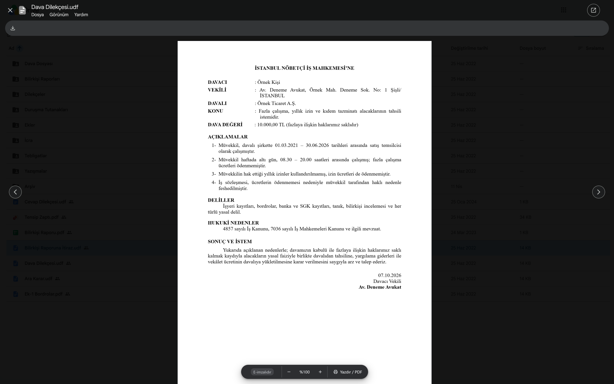
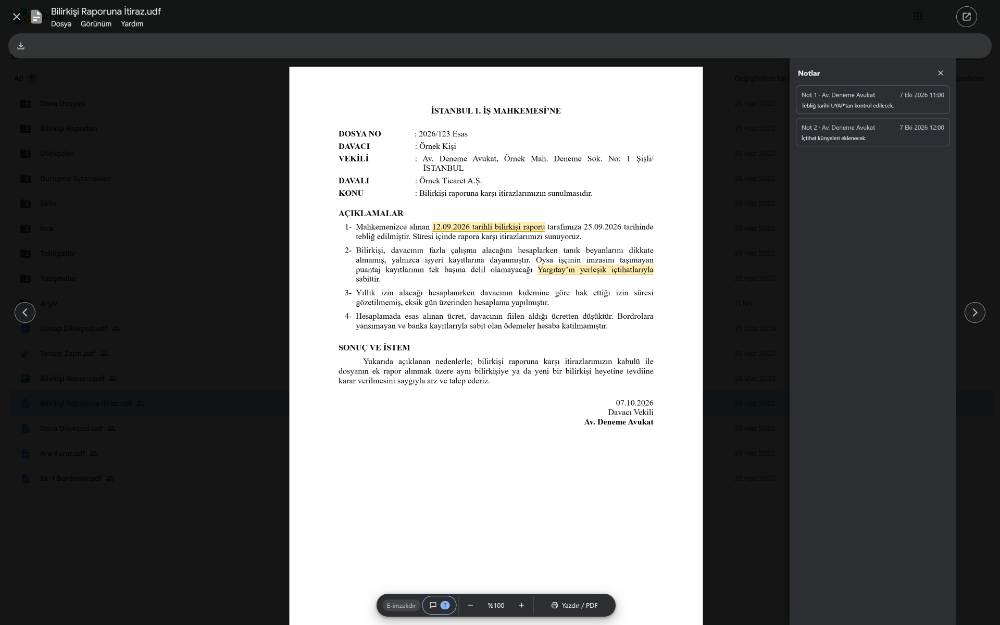

# UDF Ön İzleme

Google Drive ve Gmail, UYAP Doküman Editörü'nün `.udf` belgelerini ön izleme olarak göstermez, eklenti bu ön izlemeyi
sağlar. Google Drive'da bir `.udf` belge açmak için dosyaya çift tıklamanız, Gmail'de bir `.udf` eki açmak için eke
tıklamanız yeter: Belge, PDF'ler gibi Google'ın kendi ön izleme penceresinde açılır.

> Eklenti yalnız Google Drive (`drive.google.com`) ve Gmail (`mail.google.com`) sitelerinde çalışır. Başka sitelere
> karışmaz.

---

## Ne yapar

- **Drive'da ön izleme:** `.udf` dosyasına çift tıklayınca belge, PDF'ler gibi Drive'ın kendi ön izleme penceresinde
  açılır. Oklarla (← →) öbür dosyalara geçilir. **Esc** ya da belgenin dışına tıklamak pencereyi kapatır. Drive'ın UDF'de
  işlemeyen **Yorum** düğmesi belge açıkken gizlenir.

  
- **Gmail'de ön izleme:** Bir e-postadaki `.udf` ekine tıklayınca belge, "Önizleme yok" yerine Gmail'in kendi ön izleme
  penceresinde açılır. Oklarla (← →) e-postanın öbür eklerine geçilir. **Esc** pencereyi kapatır. Gmail'de **Yazdır /
  PDF** ile PDF kaydederken önerilen dosya adı Gmail sekmesinin adıdır (e-postanın konusu ve hesabınızın e-posta adresi),
  belgenin adını siz yazarsınız.
- **Alttaki çubuk:** Solda imza durumu ve notlar, ortada yakınlaştırma, sağda **Yazdır / PDF** (Ctrl+P).
- **Notlar:** Belgeye Editör'de eklenmiş notlar sağdaki bölmede açılır. Bir nota basınca belgede işaretlediği yere gidilir.
  Pencere daraldıkça bölme de daralır, belge tek başına sıkışmaz.

  
- **E-imza:** **E-imzalıdır**, belgede e-imza dosyası olduğunu gösterir.
- **Eklenti simgesi:** Eklentinin ayarı ve açılır penceresi yoktur. Kapatmak için `chrome://extensions` sayfasında
  eklentinin kartındaki anahtarı kapatın ve açık Drive ve Gmail sekmelerini yenileyin (F5).

---

## Kurulum

### Chrome Web Mağazası'ndan ekle

Mağaza bağlantısı, eklenti mağazada yayımlanınca buraya eklenecek.

1. Bağlantıya tıklayın, açılan sayfada **Chrome'a ekle**'ye basın.
2. Çıkan küçük pencerede **Uzantı ekle**'ye basın.
3. Açık Drive ve Gmail sekmelerini yenileyin (F5).

Kurulumdan sonra yapılacak bir ayar yoktur. Yalnız kurulumdan ya da güncellemeden önce açılmış Drive ve Gmail sekmeleri
bir kez yenilenir (F5). Bilgisayarda UYAP Doküman Editörü kurulu olması gerekmez. Eklenti, üyelik, e-posta ya da ücret
istemez.

## Gizlilik

Belgeleriniz hiçbir yere gönderilmez. Eklenti belgeyi yalnız Google'dan, tarayıcınızda açık olan kendi oturumunuzla alır
ve yalnız tarayıcınızda gösterir. Geliştiriciye ya da Google dışında bir yere hiçbir bilgi gitmez. Eklentinin bir
sunucusu yoktur. Eklenti internete bağlanmaz.

**Okuduğu bilgiler.** Eklenti belgenin içeriği dışında yalnız şunları okur:

- **Drive'da:** Ön izleme penceresindeki dosyanın kimliği, adı ve türü, Drive'da açık olan hesabın sırası (birden çok
  Google hesabıyla giriş yaptıysanız hangisi olduğu, Drive'ın adresinde yazılıysa hesabın e-posta adresi), paylaşım
  bağlantısının erişim anahtarı (`resourcekey`) ve dosya sayfasında (`drive.google.com/file/…`) sekmenin başlığı (dosyanın
  `.udf` olduğunu anlamak için).
- **Gmail'de:** Ön izleme penceresindeki dosyanın adı, hangi ek kartına bastığınız ve yalnız o kartın bulunduğu
  e-postadaki ek kartlarının adları ve indirme bağlantıları. Sayfadaki öbür e-postaların eklerine bakmaz. E-postadaki bir Drive dosyası bu pencerede açılırsa o dosyanın yukarıdaki Drive bilgileri.
  Bastığınız bağlantının adresine Drive dosyası bağlantısı mı diye bakar, erişim anahtarı için bastığınız son Drive
  bağlantısının dosya kimliğini ve erişim anahtarını alır. E-postaların metnine, konusuna, gönderenine ya da alıcılarına
  bakmaz.

**İndirme.** Drive'daki `.udf` dosyası, ön izleme penceresinde açıldığı anda Drive'ın indirme adresinden
(`drive.usercontent.google.com`), Drive'da açık olan hesabınızla. Gmail'de bir `.udf` ekinin kartına bastığınız
anda ek, belge daha çabuk açılsın diye Gmail sayfasının içinden kendi oturumunuzla indirilmeye başlar. Ön izleme
açılmazsa ek en geç 15 saniye sonra bellekten silinir, indirme sürüyorsa kesilir.

**Saklama.** Eklenti hiçbir şey saklamaz: Ayarı, geçmişi ya da kaydı yoktur, tarayıcının hiçbir deposunu kullanmaz.
Açılan belgenin bilgisi ve baytları belge açılırken bellekte durur: Bilgisi eklentinin arka planında en geç bir
dakikada, baytları indirme bittikten en geç 15 saniye sonra silinir. Belge gösterilirken yalnız ön izleme penceresinin
belleğindedir, pencere kapanınca gider. Drive ya da Gmail sekmesinin belleğinde sekme yenilenene ya da kapanana dek
yalnız son açılan dosyanın kimliği, Gmail'de bastığınız son ek kartının e-postasının kimliği ve bastığınız son Drive
bağlantısının dosya kimliğiyle erişim anahtarı kalabilir. Belgenin adı sekme başlığına ve adrese konmaz, bu yüzden
tarayıcı geçmişine düşmez. Belgeyi eklentinin **İndir** düğmesiyle bilgisayarınıza kaydederseniz dosya, adıyla Chrome'un
indirilenler listesine girer.

**İzinler.** Eklenti yalnız Drive'ın (`drive.google.com`) ve Gmail'in (`mail.google.com`) sayfalarında çalışır. Drive
dosyalarını yalnız Drive'ın indirme adresinden (`drive.usercontent.google.com`), Gmail eklerini Gmail sayfasının içinden
(`mail.google.com`) kendi oturumunuzla indirir. Başka bir izin istemez.

---

## Teşekkür

Eklentinin belge okuma motoru, Hasan İmer Akın'ın [legaluga-uyap-ui](https://github.com/hasanimer/legaluga-uyap-ui)
(© 2026 Hasan İmer Akın) projesindeki `udf.js` üzerine kuruldu. UDF biçimini çözen bu emeği herkesle paylaştığı için
kendisine buradan da teşekkür ederim.

---

Soru ve bildirimler için: [x.com/CgrShn](https://x.com/CgrShn)

Lisans: AGPL-3.0. Ayrıntılar için [LICENSE](LICENSE) dosyasına bakınız.
